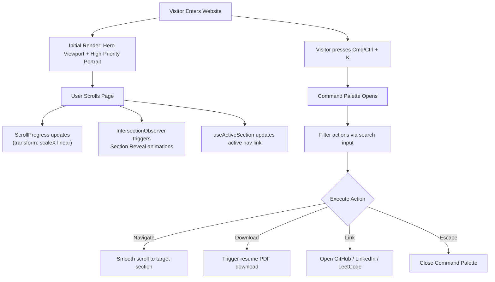

# Akshat Gupta — Personal Portfolio & Engineering Architecture

[](https://react.dev/)
[](https://vite.dev/)
[](https://oxc.rs/)
[](https://github.com/Akshat19Ak)
[](https://opensource.org/licenses/MIT)

> **Neo-Editorial Creative Engineering Portfolio** for **Akshat Gupta** — Computer Science and Engineering undergraduate at KIIT University (CGPA 8.82/10), focused on AI Systems, RAG Pipelines, Multi-Agent Architectures, and Full-Stack Software Development.

---

## Table of Contents

- [1. Executive Overview](#1-executive-overview)
- [2. System Architecture & Flowcharts](#2-system-architecture--flowcharts)
  - [2.1 Frontend Component Hierarchy](#21-frontend-component-hierarchy)
  - [2.2 Flagship System: Research Lens Hybrid RAG Architecture](#22-flagship-system-research-lens-hybrid-rag-architecture)
  - [2.3 User Interaction & State Lifecycle](#23-user-interaction--state-lifecycle)
- [3. Key Architectural Features](#3-key-architectural-features)
- [4. Project Structure & Codebase Map](#4-project-structure--codebase-map)
- [5. Getting Started & Setup Guide](#5-getting-started--setup-guide)
  - [5.1 Prerequisites](#51-prerequisites)
  - [5.2 Installation](#52-installation)
  - [5.3 Development Server](#53-development-server)
  - [5.4 Linting & Code Verification](#54-linting--code-verification)
  - [5.5 Production Build & Preview](#55-production-build--preview)
- [6. Configuration Guide (`src/config.js`)](#6-configuration-guide-srcconfigjs)
- [7. Design System & CSS Token Architecture](#7-design-system--css-token-architecture)
- [8. Performance & Optimization Engineering](#8-performance--optimization-engineering)
- [9. Accessibility (a11y) & SEO Standards](#9-accessibility-a11y--seo-standards)
- [10. Deployment Instructions](#10-deployment-instructions)
- [11. Contact & Social Profiles](#11-contact--social-profiles)

---

## 1. Executive Overview

This repository houses the complete source code for **Akshat Gupta's** personal portfolio. Rather than relying on a generic portfolio template, this project was architected from the ground up as a high-performance, single-page application (SPA) embodying **Neo-Editorial Engineering** — a marriage of editorial typography, deep near-black surfaces, disciplined visual hierarchies, and purposeful interactive systems.

### Core Candidate Profile Represented:
- **Education:** B.Tech in Computer Science and Engineering, KIIT University (Expected Graduation: May 2027 · Current CGPA: 8.82/10.0).
- **Primary Disciplines:** AI Systems Engineering, Retrieval-Augmented Generation (RAG), Autonomous Multi-Agent Workflows, Deep Learning, and Full-Stack Python REST APIs.
- **Problem Solving:** 170+ algorithmic problems solved on LeetCode with optimal time/space complexity.
- **Industry Experience:** Software Development Intern at Bhilai Steel Plant (SAIL) — June 2026.
- **Leadership:** Technical Executive of GenAI & ML at Konnexions (KIIT's Flagship AI Society) and ML Technical Executive at Coding Ninjas KIIT Chapter.

---

## 2. System Architecture & Flowcharts

### 2.1 Frontend Component Hierarchy

The application follows a unidirectional data flow architecture where content and visual presentations are decoupled. The central configuration (`src/config.js`) feeds data into modular section components managed by `src/App.jsx`.

```mermaid
flowchart TD
    subgraph Core ["Application Core (Vite + React 19)"]
        Index["index.html\n(Metadata, Fonts & Viewport)"] --> Main["src/main.jsx\n(React Root Mounting)"]
        Main --> App["src/App.jsx\n(Master Section Orchestrator)"]
    end

    subgraph ConfigLayer ["Configuration & Foundation"]
        Config["src/config.js\n(Central Source of Truth)"]
        CSS["src/index.css\n(Tokens, Reset & Typography)"]
        Icons["src/components/icons.jsx\n(Zero-dep Inline SVG Icons)"]
        Hooks["src/components/hooks.js\n(ActiveSection & CommandPalette Hooks)"]
    end

    Config --> App
    CSS --> App
    Icons --> App
    Hooks --> App

    subgraph Layout ["Global Overlays & Navigation"]
        Progress["ScrollProgress\n(CSS transform GPU tracking)"]
        Nav["Nav Bar\n(Backdrop Blur + Section Spy)"]
        Cmd["CommandPalette\n(Cmd/Ctrl + K Quick Action Modal)"]
    end

    App --> Progress
    App --> Nav
    App --> Cmd

    subgraph Sections ["Interactive Viewport Sections"]
        Hero["Hero Section\n(Portrait, Status Pill, Socials & CTAs)"]
        Story["About / Story\n(Philosophy, Rigorous Coursework & Stats)"]
        Projects["Featured Projects\n(Filter Matrix & System Architecture Explorer)"]
        Skills["Technical Arsenal\n(Categorized Stacks & LeetCode Highlight)"]
        Journey["Journey & Experience\n(Timeline, SAIL Internship & Certifications)"]
        Vision["Beyond the Builds\n(Pillars & Interactive Terminal Console)"]
        Closing["Contact & Footer\n(1-Click Email Copy, Resume & Social Links)"]
    end

    App --> Hero
    App --> Story
    App --> Projects
    App --> Skills
    App --> Journey
    App --> Vision
    App --> Closing
```



---

### 2.2 Flagship System: Research Lens Hybrid RAG Architecture

A key highlight of the portfolio is the **interactive system architecture diagram** embedded within the Projects section, detailing the engineering pipeline of Akshat's flagship application, **Research Lens**:

```mermaid
flowchart LR
    subgraph Ingestion ["1. Document Ingestion"]
        A["Academic PDF / URL"] --> B["PyPDF2 & Web Scraper"]
        B --> C["Recursive Text Splitter\n(Chunk Size: 500, Overlap: 50)"]
    end

    subgraph Vectorization ["2. Hybrid Indexing"]
        C --> D["SentenceTransformers\n(all-MiniLM-L6-v2)"]
        C --> E["BM25 Keyword Frequency\n(Sparse Vocabulary Matrix)"]
        D --> F["Dense FAISS Index\n(Pinecone Compatible)"]
        E --> G["Sparse Inverted Index"]
    end

    subgraph Retrieval ["3. Hybrid Retrieval & Fusion"]
        Q["User Query"] --> F
        Q --> G
        F --> H["Top-K Semantic Hits"]
        G --> I["Top-K Lexical Hits"]
        H & I --> J["Reciprocal Rank Fusion (RRF)\nScore Synthesis"]
        J --> K["Cross-Encoder Reranker\n(Semantic Precision Filter)"]
    end

    subgraph Synthesis ["4. Generation & Guardrails"]
        K --> L["Context-Augmented Prompt"]
        L --> M["Groq Llama 3.3 Engine\n(High-speed Inference)"]
        M --> N["Faithfulness & Relevance Scorer\n(Hallucination Monitor)"]
        N --> O["Verified Answer & Citations\n(FastAPI Endpoint to React UI)"]
    end

    style J fill:#17172a,stroke:#7c3aed,stroke-width:2px
    style K fill:#17172a,stroke:#6ee7b7,stroke-width:2px
    style N fill:#17172a,stroke:#60a5fa,stroke-width:2px
```



---

### 2.3 User Interaction & State Lifecycle



---

## 3. Key Architectural Features

| Feature | Engineering Implementation | Benefit |
|---|---|---|
| **Studio Portrait Frame** | Natural integration with ambient gradient glow, hover-depth translation, and floating badges. | Immediate personal connection without visual clutter or generic AI artifice. |
| **Command Palette (`Cmd+K`)** | Native keyboard listener, input fuzzy filtering, arrow key navigation, and direct actions. | Developer-first, high-velocity navigation for technical evaluators. |
| **Hybrid RAG Interactive Diagram** | Expandable component with live step-by-step pipeline stages. | Proves deep architectural understanding of modern GenAI systems. |
| **Multi-Agent Showcase** | Highlights OmniView's CrewAI debate pipeline (Optimist, Risk Analyst, Moderator). | Demonstrates practical agent orchestration beyond single-prompt completions. |
| **Interactive Terminal Console** | CLI simulator showcasing engineering principles and system rules. | Interactive proof of first-principles thinking and Linux/Docker fluency. |
| **Tabbed Journey Hub** | Unified switcher for Chronological Path, Work Experience (SAIL), and Certifications. | Prevents endless vertical scrolling while maintaining full credential depth. |
| **1-Click Email Clipboard** | Uses navigator.clipboard with state-driven feedback (`Copied to Clipboard!`). | Minimizes friction for recruiters and engineering hiring managers. |

---

## 4. Project Structure & Codebase Map

```
gs - Copy/
├── public/
│   ├── akshat-portrait.jpg        # Professional studio portrait photograph (280KB optimized)
│   ├── Akshat_Gupta_Resume.pdf    # Direct-download verified resume PDF
│   ├── favicon.svg                # Neural graph SVG favicon
│   └── icons.svg                  # Legacy vector asset repository
├── src/
│   ├── components/
│   │   ├── Closing.css            # Styles for contact card, links, and footer
│   │   ├── Closing.jsx            # Contact section with 1-click email copy & resume download
│   │   ├── Hero.css               # Hero layout, ambient spotlight, and portrait frame
│   │   ├── Hero.jsx               # Hero landing section with interactive mouse-spotlight
│   │   ├── hooks.js               # useActiveSection and useCommandPalette custom hooks
│   │   ├── icons.jsx              # Lightweight, zero-dependency inline SVG icons
│   │   ├── Journey.css            # Timeline track, marker pills, and certification cards
│   │   ├── Journey.jsx            # 3-tab journey, work experience & credential section
│   │   ├── Projects.css           # Grid styles, filter pills, and RAG architecture diagram
│   │   ├── Projects.jsx           # Featured builds with live demo/code links & RAG explorer
│   │   ├── shared.jsx             # Nav, ScrollProgress, Reveal wrapper, and CommandPalette
│   │   ├── Skills.css             # Capability matrix, card hover states, and chip tags
│   │   ├── Skills.jsx             # Categorized technical arsenal with LeetCode highlight
│   │   ├── Story.css              # Editorial narrative layout and stat cards
│   │   ├── Story.jsx              # About me: first-principles engineering & coursework
│   │   ├── Vision.css             # Vision pillars and interactive engineering CLI lab
│   │   └── Vision.jsx             # "Who I Want To Be" & Beyond the Builds Terminal
│   ├── App.jsx                    # Root layout integrating all section modules
│   ├── config.js                  # Central configuration: single source of truth for all content
│   ├── index.css                  # Global design tokens, typography, and utility classes
│   └── main.jsx                   # React 19 application bootstrap
├── index.html                     # HTML5 shell, OpenGraph/Twitter cards & Google Fonts
├── package.json                   # Project metadata, dependencies, and build scripts
├── vite.config.js                 # Vite bundler configuration with React plugin
└── README.md                      # Comprehensive engineering documentation
```

---

## 5. Getting Started & Setup Guide

### 5.1 Prerequisites

Ensure your environment meets the minimum version requirements:
- **Node.js:** `v18.0.0` or higher (Node 20+ recommended)
- **npm:** `v9.0.0` or higher (or `pnpm` / `yarn`)

Verify your installation:
```bash
node -v
npm -v
```

### 5.2 Installation

Clone the repository and enter the workspace directory:
```bash
git clone https://github.com/Akshat19Ak/portfolio.git
cd "gs - Copy"
```

Install dependencies:
```bash
npm install
```

### 5.3 Development Server

Start Vite's development server with instantaneous Hot Module Replacement (HMR):
```bash
npm run dev
```

The application will start immediately. Open your browser and navigate to:
```
http://localhost:5173
```
*(If port 5173 is occupied, Vite will automatically increment to 5174 or display the assigned port in the terminal).*

### 5.4 Linting & Code Verification

Run **Oxlint** to verify code quality and ensure zero syntax, purity, or React lint warnings:
```bash
npm run lint
```
*Expected output:* `Found 0 warnings and 0 errors.`

### 5.5 Production Build & Preview

Compile and bundle the project for production deployment using Rolldown/Vite:
```bash
npm run build
```

This generates an ultra-optimized static bundle in the `dist/` directory:
```
dist/index.html                   ~2.4 kB │ gzip: ~0.9 kB
dist/assets/index-[hash].css     ~35.6 kB │ gzip: ~7.1 kB
dist/assets/index-[hash].js      ~281.1 kB │ gzip: ~84.3 kB
```

Preview the production build locally on port 4173:
```bash
npm run preview
```

---

## 6. Configuration Guide (`src/config.js`)

All data displayed on the portfolio is decoupled from presentation components and centralized in `src/config.js`. You can update all portfolio information without touching JSX code.

### Updating Personal Identity:
```javascript
export const config = {
  name: "Akshat Gupta",
  portrait: "/akshat-portrait.jpg",
  headline: "Building Intelligent Software.",
  subheadline: "AI Engineering · Machine Learning · Full-Stack Development",
  introduction: "Computer Science undergraduate building at the intersection...",
  email: "akshat19official@gmail.com",
  phone: "+91 8815975797",
  location: "Bhubaneswar, Odisha",
  resumeUrl: "/Akshat_Gupta_Resume.pdf",
  github: "https://github.com/Akshat19Ak",
  linkedin: "https://www.linkedin.com/in/akshatgupta105/",
  leetcode: "https://leetcode.com/u/Akshat_1_Gupta/",
  ...
};
```

### Adding a New Project:
```javascript
{
  id: "your-project-id",
  title: "Project Name",
  subtitle: "Core Technical Category",
  category: "AI / RAG Systems", // Controls filter pill categorization
  featured: true,
  description: "High-level summary of what problem the project solves...",
  highlights: [
    "Engineered X using Y to achieve Z",
    "Deployed to production with Docker and FastAPI"
  ],
  tech: ["Python", "FastAPI", "Docker", "Pinecone"],
  github: "https://github.com/Akshat19Ak/project-repo",
  live: "https://project-demo.vercel.app/" // Set to null if code-only
}
```

---

## 7. Design System & CSS Token Architecture

The design system is constructed in `src/index.css` using modern CSS Custom Properties:

```css
:root {
  /* Surfaces */
  --bg-deep:       #08080f; /* Primary canvas background */
  --bg-surface:    #0e0e18; /* Section contrast layer */
  --bg-elevated:   #141422; /* Modals, Command Palette */
  --bg-card:       #17172a; /* Card background */
  --bg-card-hover: #1c1c35; /* Card hover transformation */

  /* Hairline Borders */
  --border:        rgba(139, 112, 220, 0.1);
  --border-hover:  rgba(139, 112, 220, 0.25);

  /* Typography */
  --text-primary:   #f0eef8;
  --text-secondary: #9d9ab8;
  --text-muted:     #5c5977;
  --text-accent:    #a78bfa;

  /* Accent Glows */
  --violet:        #7c3aed;
  --violet-light:  #a78bfa;
  --mint:          #6ee7b7;
  --blue:          #60a5fa;

  /* Easing curves */
  --ease-out:      cubic-bezier(0.16, 1, 0.3, 1);
}
```

---

## 8. Performance & Optimization Engineering

1. **Zero External Icon Libraries:**
   All icons are embedded as inline SVG functional components in `src/components/icons.jsx`. This eliminates third-party icon bundle bloat, prevents layout shifts, and ensures immediate rendering.
2. **GPU-Accelerated Transforms:**
   All hover states, spotlight tracking, floating badges, and the top scroll indicator manipulate `transform` and `opacity` properties exclusively, avoiding browser reflows and paint bottlenecks.
3. **Optimized Static Asset Delivery:**
   The professional portrait photograph was pre-compressed to ~280KB Web-optimized JPG format with `loading="eager"` and `fetchPriority="high"` above the fold.
4. **Bundle Efficiency:**
   The complete production bundle compiles to under 85KB gzipped JavaScript, ensuring near-instant First Contentful Paint (FCP) and Time to Interactive (TTI).

---

## 9. Accessibility (a11y) & SEO Standards

- **Semantic HTML5:** Strict utilization of `<header>`, `<nav>`, `<main>`, `<section>`, `<article>`, and `<footer>` tags.
- **Accessible ARIA:** `role="navigation"`, `role="dialog"`, `role="tablist"`, `aria-selected`, and `aria-expanded` attributes are implemented across interactive elements.
- **Motion Reduction:** Fully respects the operating system's `prefers-reduced-motion` flag:
  ```css
  @media (prefers-reduced-motion: reduce) {
    *, *::before, *::after {
      animation-duration: 0.01ms !important;
      transition-duration: 0.01ms !important;
      scroll-behavior: auto !important;
    }
  }
  ```
- **SEO & Social Metadata:** Fully configured in `index.html` with Open Graph (`og:title`, `og:image`, `og:description`), Twitter Cards (`summary_large_image`), viewport optimizations, and preconnect hints for Google Fonts.

---

## 10. Deployment Instructions

### Deploy to Vercel (Recommended)
1. Install the Vercel CLI:
   ```bash
   npm i -g vercel
   ```
2. Deploy directly from the project directory:
   ```bash
   vercel
   ```
3. Set the build settings:
   - **Framework Preset:** Vite
   - **Build Command:** `npm run build`
   - **Output Directory:** `dist`

### Deploy to Netlify
1. Connect your GitHub repository at [app.netlify.com](https://app.netlify.com).
2. Configure settings:
   - **Build command:** `npm run build`
   - **Publish directory:** `dist`
3. Click **Deploy Site**.

### Deploy via Docker
Create a `Dockerfile` in the root:
```dockerfile
# Stage 1: Build
FROM node:20-alpine AS build
WORKDIR /app
COPY package*.json ./
RUN npm install
COPY . .
RUN npm run build

# Stage 2: Serve
FROM nginx:alpine
COPY --from=build /app/dist /usr/share/nginx/html
EXPOSE 80
CMD ["nginx", "-g", "daemon off;"]
```

---

## 11. Contact & Social Profiles

- **Email:** [akshat19official@gmail.com](mailto:akshat19official@gmail.com)
- **Phone:** [+91 8815975797](tel:+918815975797)
- **LinkedIn:** [linkedin.com/in/akshatgupta105](https://www.linkedin.com/in/akshatgupta105/)
- **GitHub:** [github.com/Akshat19Ak](https://github.com/Akshat19Ak)
- **LeetCode:** [leetcode.com/u/Akshat_1_Gupta](https://leetcode.com/u/Akshat_1_Gupta/)
- **Location:** Bhubaneswar, Odisha, India

---

*Designed and engineered by Akshat Gupta. All listed projects, coursework, and credentials reflect verified implementations.*
